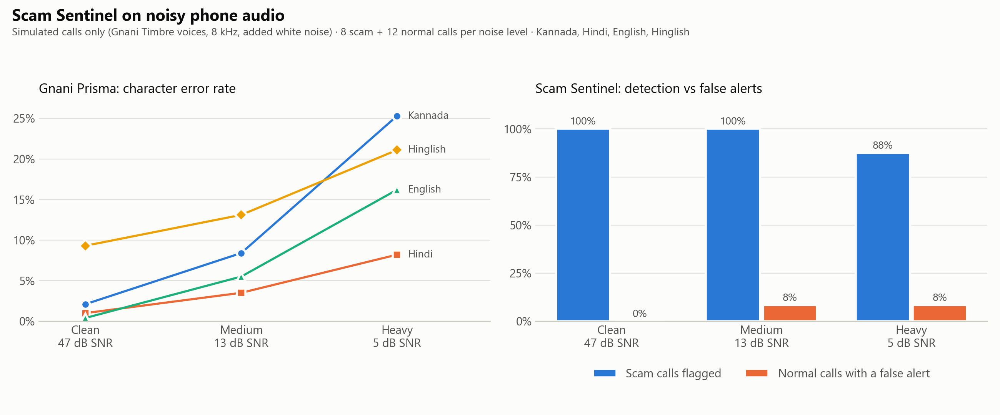
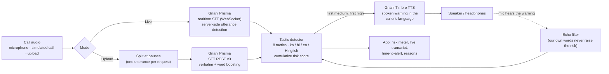

# Scam Sentinel 🛡️

**A voice scam-call shield for Indian languages.** It listens to a phone call as it happens, spots scam
tactics building up (fake police or bank officials, arrest threats, "tell me the OTP", "install
AnyDesk"), and **speaks a calm warning in the listener's language** (Kannada, Hindi, English or
Hinglish) before the money is gone.

Built on **Gnani AI**: Prisma speech-to-text (REST and realtime) to listen, Timbre text-to-speech to warn.
Entry for the Great Indian AI Internship Challenge (#GnaniAI #GreatIndianAIInternshipChallenge).

> ⚠️ **Decision aid, not a guarantee.** If a call feels wrong, hang up and call India's national cyber
> crime helpline **1930**, or report at **cybercrime.gov.in**.
> **All demo calls and benchmark audio are simulated**: scripts written for this project, spoken by
> Gnani Timbre voices. No real calls, phone numbers, account numbers or people appear anywhere.

## Results at a glance

**Live, mid-call** (Prisma realtime STT):

| Test | Medium warning | High warning |
|---|---|---|
| Simulated Kannada "KYC expired" scam call (19 s) | at 12.2 s ("your account will be blocked today") | at 19.7 s (OTP request), before the call ends |
| Developer reading a scam script into the laptop mic (English) | | at 22.3 s, while still speaking |

**Noise benchmark**: 20 simulated calls (8 scam, 12 normal incl. bank awareness messages and
delivery-OTP calls) in 4 languages × 3 noise levels, full app path. Details: [`results/benchmark.md`](results/benchmark.md).

| Noise | SNR | Prisma char error | Scams flagged | Normal calls with a false alert |
|---|---|---|---|---|
| Clean | 47 dB | 3.2% | 8/8 (100%) | 0/12 (0%) |
| Medium (noisy mobile) | 13 dB | 7.7% | 8/8 (100%) | 1/12 (8%) |
| Heavy (noise ≈ voice) | 5 dB | 17.7% | 7/8 (88%) | 1/12 (8%) |



Speech-to-text errors grow more than fivefold from clean to heavy noise, but detection holds, because the
detector looks for *several tactics adding up over the call* rather than any single word. The misses are
reported as they happened (see [Limits](#limits)).

## How it works



1. **Listen.** Live mode streams 1024-byte PCM frames to Prisma's realtime endpoint and gets a
   transcript per utterance. Uploads are split at natural pauses and sent one utterance per request.
2. **Score.** Eight weighted tactics (authority, threat, urgency, secrecy, credentials, payment, remote
   access, lure) with Kannada, Hindi, English and Hinglish keywords, including the spellings Prisma
   actually produces ("ಒ ಟಿ ಪಿ", "any desk", "call khat mat"). Combinations score extra (an "official"
   **plus** an OTP request). Awareness messages ("never share your OTP") and delivery-OTP hand-overs are
   recognised and discounted, but only if nothing else is escalating.
3. **Warn.** The first time the running score crosses *medium* and *high*, Timbre speaks a pre-generated
   warning (cached, so it plays instantly) with the helpline number read digit by digit.

## Gnani models and APIs used

| Gnani | Used for | Details |
|---|---|---|
| **Prisma STT, realtime** (`wss://api.vachana.ai/stt/v3/stream`) | Live mode | `kn-IN`, `hi-IN`, `en-IN` (also Hinglish); 8 or 16 kHz; word boosting via `x-bias-list`; reconnects before the 15-minute session cap |
| **Prisma STT, REST** (`POST /stt/v3`) | Uploaded calls, benchmark | verbatim mode + `bias_list` word boosting on scam keywords |
| **Timbre TTS** (`POST /api/v1/tts/inference`) | Spoken warnings | v3.0 voice *Chetana* (all languages), falling back to v2.5 |
| **Timbre TTS** | Simulated calls | v2.5 voices Kavin/Saanvi (kn), Deepak/Nalini (hi), Pranav/Kaveri (en), Deepak/Poorvi (Hinglish), 8 kHz WAV |
| Evon 30B (optional) | Second opinion on a full call | any OpenAI-compatible server via `EVON_BASE_URL`; can only raise the level |

## Run it

Windows, Python 3.12. One command does the setup on first run and starts the app:

```powershell
powershell -ExecutionPolicy Bypass -File .\run.ps1
```

Put your key from app.gnani.ai (Speech-to-Text + Text-to-Speech access) in `.env` (created from
`.env.example` on first run), or paste it into the app sidebar. Then open http://localhost:8501:

- **🔴 Live**: microphone (16 kHz, or 8 kHz to mimic a phone line) or a simulated call file. Tick
  "I'm using headphones" if you are. Set a stop time; the cost estimate is shown before you start.
- **🎧 Analyze a call**: record or upload a recording.
- **📝 Paste a script**: free, no API calls.

Command line:

```powershell
.\.venv\Scripts\python.exe live.py --lang kn-IN                                   # live, microphone
.\.venv\Scripts\python.exe live.py --lang kn-IN --file demo_calls\corpus\kn_scam_kyc_noisy.wav --play
.\.venv\Scripts\python.exe make_transcripts.py      # simulated corpus -> Prisma transcripts (plan; --yes to spend)
.\.venv\Scripts\python.exe eval_detector.py --details   # detector accuracy on saved transcripts (free)
.\.venv\Scripts\python.exe benchmark.py             # noise benchmark (plan; --yes to spend; --report from cache)
.\.venv\Scripts\python.exe usage_report.py          # credits used, from the local ledger
powershell -ExecutionPolicy Bypass -File .\run.ps1 -Test   # 102 offline tests, no credits
```

## Credits: measured, logged, guarded

Gnani does not publish per-unit prices, so they were measured against the dashboard:

| | Measured rate | In practice |
|---|---|---|
| Prisma STT, REST | ≈0.0097 credits / s | ≈0.58 per minute |
| Prisma STT, realtime | ≈0.0073 credits / s streamed | ≈0.44 per minute |
| Timbre TTS | ≈2.9 credits / 1000 characters | ≈0.5 per spoken warning |

Every real call is appended to `usage_ledger.jsonl`; results are cached by content hash, so reruns are
free; and a **budget guard** prints the estimated cost before each call and refuses anything that would
dip into a 20% reserve. The whole project, including all tests, the benchmark and the live trials, used
about 30 of 5,000 programme credits.

## Engineering notes (found by testing against the real API)

- **Prisma REST (`kn-IN`) can return only the first sentence of a multi-sentence clip.** Sending one
  utterance per request fixed it, so calls are now split at pauses (silence is never billed either).
- **Acronyms come back letter by letter** ("ಒ ಟಿ ಪಿ", "ಕೆ ವೈ ಸಿ") and brands split ("any desk"), so
  Kannada/Hindi keywords match with optional spaces.
- **Code-mixed speech**: "OTP share maadbedi" / "शेयर मत करें" are everyday phrasing; without them a bank
  awareness message was flagged as a scam.
- **Timbre WAV headers** carry placeholder sizes (0xFFFFFFFF); the client rewrites them.
- **The microphone can hear our own warning**; an echo filter recognises the known warning words.
- **Antivirus HTTPS scanning** (Avast) broke Python's certificate check; `truststore` verifies against
  the Windows certificate store instead (verification stays on).

## Project layout

| File | What it does |
|---|---|
| `app.py`, `live_ui.py` | Streamlit app (Live, Analyze, Paste tabs) |
| `live.py` | Realtime STT session, alerts, echo filter, CLI |
| `pipeline.py` | Upload path: split at pauses, transcribe, score, speak |
| `detector.py`, `tactics.py` | Rule-based tactic detector and keyword lists |
| `alerts.py` | Warning text in kn / hi / en |
| `gnani_client.py` | Prisma + Timbre REST client: retries, cache, budget guard, offline mode |
| `budget.py`, `rates.json`, `usage_report.py`, `calibrate.py` | Credit ledger, rates, guard |
| `corpus.py`, `make_transcripts.py`, `eval_detector.py` | Simulated calls, transcripts, detector evaluation |
| `benchmark.py`, `results/` | Noise benchmark and its outputs |
| `audio_utils.py`, `text_norm.py` | WAV helpers, text normalisation |
| `docs/` | Demo storyboard, post drafts, submission text, native-speaker review checklist |

## Limits

- **Small, simulated test set.** 8 scam and 12 normal calls; percentages move in big steps. Real scam
  calls are longer and less scripted. The detector was tuned on the clean and medium transcripts;
  only the heavy-noise level is unseen.
- **At about 0 dB SNR speech recognition can change the meaning.** In the benchmark it lost an OTP
  request in one Kannada scam call and turned "don't share" into "may share" in a Kannada awareness
  message. In medium noise "parcel" was heard as "password" and caused a brief false alert.
- **Keyword rules, not understanding.** A scam that avoids every listed tactic will not be caught;
  Evon (optional) can add a second opinion.
- **Native-speaker review pending** for the Kannada and Hindi text: see `docs/review_checklist.md`.
- Not a replacement for judgement: it is a decision aid. Helpline **1930**, **cybercrime.gov.in**.
