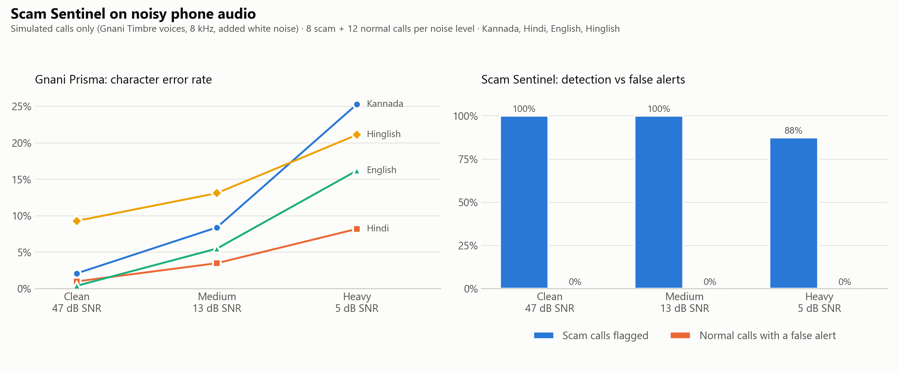
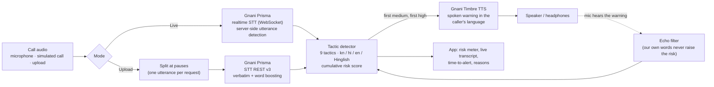

# Scam Sentinel 🛡️

**A voice scam-call shield for Indian languages.** It listens to a phone call as it happens, spots scam
tactics building up (fake police or bank officials, arrest threats, "tell me the OTP", "install
AnyDesk"), and **speaks a calm warning in the listener's language** (Kannada, Hindi, English or
Hinglish) before the money is gone.

Built on **Gnani AI**: Prisma speech-to-text (REST and realtime) to listen, Timbre text-to-speech to warn.
Entry for the Great Indian AI Internship Challenge (#GnaniAI #GreatIndianAIInternshipChallenge).

**Live demo:** https://scam-sentinel-npzc.onrender.com (the first load can take about a minute on free hosting) ·
**Video walkthrough:** https://drive.google.com/file/d/1nHNSRK4nCbpDRNfD_43L-jv-EDohMsq5/view

> ⚠️ **Decision aid, not a guarantee.** If a call feels wrong, hang up and call India's national cyber
> crime helpline **1930**, or report at **cybercrime.gov.in**.
> **All demo calls and benchmark audio are simulated**: scripts written for this project, spoken by
> Gnani Timbre voices. No real calls, phone numbers, account numbers or people appear anywhere.

## Results at a glance

**Live, mid-call** (Prisma realtime STT; measured from the start of the call audio to the warning, so speech
recognition delay is included):

| Test | Medium warning | High warning |
|---|---|---|
| Simulated Kannada "KYC expired" scam call (19 s) | at 12.2 s ("your account will be blocked today") | at 19.7 s (OTP request), before the call ends |
| Developer reading a scam script into the laptop mic (English) | | at 22.3 s, while still speaking |

**Noise benchmark**: 20 synthetic call scripts (8 scam, 12 normal incl. bank awareness messages and
delivery-OTP calls) in 4 languages, each played at 3 noise levels through the full app path: 60 runs of the
same 20 scripts, not 60 independent calls. A false alert counts if it fired at any point, even if it later
cleared. Details: [`results/benchmark.md`](results/benchmark.md).

| Noise | SNR | Prisma char error | Scams flagged | Normal calls with a false alert (any point) |
|---|---|---|---|---|
| Clean | 47 dB | 3.2% | 8/8 (100%) | 0/12 (0%) |
| Medium (noisy mobile) | 13 dB | 7.7% | 8/8 (100%) | 1/12 (8%) |
| Heavy (noise ≈ voice) | 5 dB | 17.7% | 7/8 (88%) | 1/12 (8%) |



Speech-to-text errors grow more than fivefold from clean to heavy noise, but detection holds, because the
detector looks for *several tactics adding up over the call* rather than any single word. The misses are
reported as they happened (see [Limits](#limits)).

## How it works



1. **Listen.** Live mode streams 1024-byte PCM frames to Prisma's realtime endpoint and gets a
   transcript per utterance. Uploads are split at natural pauses and sent one utterance per request.
2. **Score.** Nine weighted tactics (authority, threat, urgency, secrecy, credentials, a direct OTP
   request, payment, remote access, lure) with Kannada, Hindi, English and Hinglish keywords, including the spellings Prisma
   actually produces ("ಒ ಟಿ ಪಿ", "any desk", "call khat mat"). Combinations score extra (an "official"
   **plus** an OTP request). Awareness messages ("never share your OTP") and delivery-OTP hand-overs are
   recognised and discounted, but only if nothing else is escalating.
3. **Warn.** The first time the running score crosses *medium* and *high*, Timbre speaks a pre-generated
   warning (cached, so it plays instantly) with the helpline number read digit by digit.
4. **Family voice (optional).** An elderly parent is far more likely to hang up when their son or
   daughter says "this is a scam, cut the call" than when an app does. A family member records 20 s of
   their *own* voice once; the high-risk warning is then spoken in an AI clone of that voice (Gnani voice
   cloning), always labelled as a clone. Only your own voice, with consent. The recording and profile are stored locally in `voice/`;
   the reference audio is sent to Gnani once to create the voice embedding, and the embedding is sent with
   each warning that is synthesised.

## The website (live demo)

`phone_relay.py` serves the hosted site (Render, `render.yaml`):

- **Speakerphone listener** (`/`, public): put a real call on speaker next to a second device; it listens
  through its microphone and warns out loud during the call. Free public sessions are limited to 2 minutes,
  one start per network every 90 seconds and about 16 minutes a day in total.
- **Protected two-phone call** (private, needs the key): the call itself runs through the server, which
  listens to the caller only and warns the receiver. Optional **OTP guard** and **family guardian** phone.
- **Practice** (`/practice`): quiz plus "Check a call" (typed words scored by the same rules; no AI credits).
- **Real scams** (`/scams`): reported Indian cases with sources and spoken explanations.

If speech recognition drops during a call, the protected phone switches to **"Protection paused"** (and
"Protection stopped" if it cannot reconnect) instead of keeping its last state, and the family guardian is
told. A low score is shown as **"No warning signs yet"**, never as "safe".

### Data flow and privacy

- Caller audio is streamed to Gnani Prisma for transcription; warnings are synthesised by Gnani Timbre.
- **Public (no-key) sessions are never written to disk.** Private-demo sessions save the caller's
  transcript segments in `data/live_sessions/` on the host, for the operator view and evaluation.
- With the OTP guard on, the protected person's words are reduced to digit counts; their text is not kept.
- Every response carries security headers (CSP, `nosniff`, `no-referrer`, frame blocking).
- Prototype limits: one call at a time; a single private key (in the link) for all private roles, not
  per-person tokens; the public daily limit is kept in memory, so a server restart resets it.

## Gnani models and APIs used

| Gnani | Used for | Details |
|---|---|---|
| **Prisma STT, realtime** (`wss://api.vachana.ai/stt/v3/stream`) | Live mode | `kn-IN`, `hi-IN`, `en-IN` (also Hinglish); 8 or 16 kHz; word boosting via `x-bias-list`; reconnects before the 15-minute session cap |
| **Prisma STT, REST** (`POST /stt/v3`) | Uploaded calls, benchmark | verbatim mode + `bias_list` word boosting on scam keywords |
| **Timbre TTS** (`POST /api/v1/tts/inference`) | Spoken warnings | v3.0 voice *Chetana* (all languages), falling back to v2.5 |
| **Timbre TTS** | Simulated calls | v2.5 voices Kavin/Saanvi (kn), Deepak/Nalini (hi), Pranav/Kaveri (en), Deepak/Poorvi (Hinglish), 8 kHz WAV |
| **Voice cloning** (`POST /api/v1/tts/voice-clone/embeddings`, model `vachana-vc-v1`) | Family-voice warning | one 20 s reference of the developer's own voice; works in Kannada and English (verified: Prisma transcribed both cloned warnings back with 0% character error) |
| Evon 30B (optional) | Second opinion on a full call | any OpenAI-compatible server via `EVON_BASE_URL`; can only raise the level |

## Run it

Windows, Python 3.12. One command does the setup on first run and starts the app:

```powershell
powershell -ExecutionPolicy Bypass -File .\run.ps1
```

Put your key from app.gnani.ai (Speech-to-Text + Text-to-Speech access) in `.env` (created from
`.env.example` on first run), or paste it into the app sidebar. Then open http://localhost:8501:

- **🔴 Live**: microphone (16 kHz, or 8 kHz to mimic a phone line) or a simulated call file. Tick
  "I'm using headphones" if you are. Set a stop time; the cost estimate is shown before you start.
- **🎧 Analyze a call**: record or upload a recording.
- **📝 Paste a script**: free, no API calls.

Command line:

```powershell
.\.venv\Scripts\python.exe live.py --lang kn-IN                                   # live, microphone
.\.venv\Scripts\python.exe make_transcripts.py      # simulated corpus audio + Prisma transcripts (plan; --yes to spend)
.\.venv\Scripts\python.exe live.py --lang kn-IN --file demo_calls\corpus\kn_scam_kyc_noisy.wav --play   # after the line above
.\.venv\Scripts\python.exe eval_detector.py --details   # detector accuracy on saved transcripts (free)
.\.venv\Scripts\python.exe benchmark.py             # noise benchmark (plan; --yes to spend; --report from cache)
.\.venv\Scripts\python.exe usage_report.py          # credits used, from the local ledger
.\.venv\Scripts\python.exe family_voice.py record --lang kn      # family voice: record 20 s of YOUR voice (free)
.\.venv\Scripts\python.exe family_voice.py enroll --name "Your name" --i-am-the-speaker
.\.venv\Scripts\python.exe live.py --lang kn-IN --family-voice    # high warning in that voice (labelled)
.\.venv\Scripts\python.exe family_voice.py delete               # remove the recording, profile, clones
powershell -ExecutionPolicy Bypass -File .\run.ps1 -Test   # 295 offline tests, no credits
.\.venv\Scripts\python.exe phone_relay.py           # the website on http://localhost:8765 (needs GNANI_API_KEY for calls)
```

## Credits: measured, logged, guarded

Gnani does not publish per-unit prices, so they were measured against the dashboard:

| | Measured rate | In practice |
|---|---|---|
| Prisma STT, REST | ≈0.0097 credits / s | ≈0.58 per minute |
| Prisma STT, realtime | ≈0.0073 credits / s streamed | ≈0.44 per minute |
| Timbre TTS | ≈2.9 credits / 1000 characters | ≈0.5 per spoken warning |
| Voice-cloned TTS | ≈2.8 credits / 1000 characters | same as standard TTS; enrolment ~free |

Every real call is appended to `usage_ledger.jsonl`; results are cached by content hash, so reruns are
free; and a **budget guard** prints the estimated cost before each call and refuses anything that would
dip into a 20% reserve. The whole project, including all tests, the benchmark and the live trials, used
about 30 of 5,000 programme credits.

## Engineering notes (found by testing against the real API)

- **Prisma REST (`kn-IN`) can return only the first sentence of a multi-sentence clip.** Sending one
  utterance per request fixed it, so calls are now split at pauses (silence is never billed either).
- **Acronyms come back letter by letter** ("ಒ ಟಿ ಪಿ", "ಕೆ ವೈ ಸಿ") and brands split ("any desk"), so
  Kannada/Hindi keywords match with optional spaces.
- **Code-mixed speech**: "OTP share maadbedi" / "शेयर मत करें" are everyday phrasing; without them a bank
  awareness message was flagged as a scam.
- **Timbre WAV headers** carry placeholder sizes (0xFFFFFFFF); the client rewrites them.
- **The microphone can hear our own warning**; an echo filter recognises the known warning words.
- **Antivirus HTTPS scanning** (Avast) broke Python's certificate check; `truststore` verifies against
  the Windows certificate store instead (verification stays on).

## Project layout

| File | What it does |
|---|---|
| `app.py`, `live_ui.py` | Streamlit app (Live, Analyze, Paste tabs) |
| `live.py` | Realtime STT session, alerts, echo filter, CLI |
| `pipeline.py` | Upload path: split at pauses, transcribe, score, speak |
| `detector.py`, `tactics.py` | Rule-based tactic detector and keyword lists |
| `alerts.py` | Warning text in kn / hi / en |
| `gnani_client.py` | Prisma + Timbre REST client: retries, cache, budget guard, offline mode |
| `budget.py`, `rates.json`, `usage_report.py`, `calibrate.py` | Credit ledger, rates, guard |
| `corpus.py`, `make_transcripts.py`, `eval_detector.py` | Simulated calls, transcripts, detector evaluation |
| `benchmark.py`, `results/` | Noise benchmark and its outputs |
| `family_voice.py` | Family-voice warning: record, enrol, preview, delete (own voice only) |
| `phone_relay.py`, `web/` | The website: speakerphone listener, protected call, family guardian, Practice, Real scams |
| `otp_guard.py` | OTP guard: counts digits spoken after an OTP or money request |
| `android/probe/` | Experiment: can an app on the same phone hear a normal call? (it could not) |
| `audio_utils.py`, `text_norm.py` | WAV helpers, text normalisation |
| `docs/` | Demo storyboard, post drafts, submission text, native-speaker review checklist |

## Limits

- **Small, simulated test set.** 8 scam and 12 normal calls; percentages move in big steps. Real scam
  calls are longer and less scripted. The detector was tuned on the clean and medium transcripts;
  only the heavy-noise level is unseen.
- **At about 0 dB SNR speech recognition can change the meaning.** In the benchmark it lost an OTP
  request in one Kannada scam call and turned "don't share" into "may share" in a Kannada awareness
  message. In medium noise "parcel" was heard as "password" and caused a brief false alert.
- **Keyword rules, not understanding.** A scam that avoids every listed tactic will not be caught;
  Evon (optional) can add a second opinion. Reworded requests found in review ("read me the six-digit
  verification code", "scan this QR", "approve the collect request") and police safety advice full of
  "never" are kept as regression tests in `tests/test_paraphrases.py`; that is a growing check, not a
  measured real-world accuracy.
- **The OTP guard reacts; it does not guarantee no leak.** It fires once about three digits have been
  recognised after an OTP or money request, so some digits may already have reached the caller. In the
  two-phone call it then stops sending the protected person's voice; on speakerphone it can only warn.
- **Protection depends on the speech service.** If Gnani is unreachable, the phone says so ("Protection
  paused / stopped"), but it cannot warn about what it did not hear.
- **Benchmark time-to-alert** in `results/benchmark.md` is measured on the call's own timeline (when the
  words were spoken); it does not include recognition delay. The live times at the top do.
- **Voice cloning is powerful and misusable.** This project only clones the developer's own voice, asks
  for explicit confirmation (`--i-am-the-speaker`), labels every cloned warning on screen, keeps the
  recording and embedding local (never committed) and can delete them. The warning text is fixed, so the
  clone cannot be made to say anything else from the app.
- **Native-speaker review pending** for the Kannada and Hindi text: see `docs/review_checklist.md`.
- Not a replacement for judgement: it is a decision aid. Helpline **1930**, **cybercrime.gov.in**.

## License

MIT, see [LICENSE](LICENSE). Tests run automatically on every push (GitHub Actions, Windows, Python 3.12).
